# PixelBit

PixelBit is a handheld arcade you can fit in your pocket. It's an ESP8266, a tiny OLED screen, and four buttons. It has 14 games, and you can link two of them together and play each other. No wifi or router needed. It runs PixelOS v4.2.


<p align="center">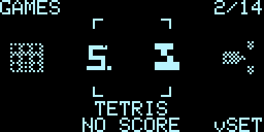<br><sub>The menu on the OLED (screen capture from the PC emulator)</sub></p>

> ## Credit
> **This is a fork of [Arduino-Game-System](https://github.com/innif/Arduino-Game-System) by Finn Harms ([innif](https://github.com/innif)).** All credit for the hardware, the case, the build instructions and the first eight games goes to them. The case and the original project are on [MakerWorld](https://makerworld.com/en/models/1526306-tiny-retro-arcade-8-games). Go star the [original repo](https://github.com/innif/Arduino-Game-System) and thank them.
>
> **What I added:** six new games, rewrites of the original eight, a new menu, per-game settings, a welcome animation and tour for the first boot, two-console play, a manufacturing test mode, a PC emulator, and automated tests.
>
> **About the AI:** I used an AI coding assistant (Claude) to write most of the code in this fork. I told it what to build, tested everything, and ran it on a real console. I'm saying it up front because I'd rather you hear it from me.
>
> This is under the **GNU General Public License v3.0**, same as the original. See [LICENSE.md](LICENSE.md).

## Contents

- [Games](#games)
- [Features](#features)
- [Build it](#build-it)
- [Install the firmware](#install-the-firmware)
- [Using the console](#using-the-console)
- [Playing a friend](#playing-a-friend)
- [Saved data](#saved-data)
- [Manufacturing test mode](#manufacturing-test-mode)
- [Console-to-console firmware update](#console-to-console-firmware-update)
- [For tinkerers](#for-tinkerers)
- [Troubleshooting](#troubleshooting)
- [License](#license)

## Games

<table>
<tr>
<td align="center">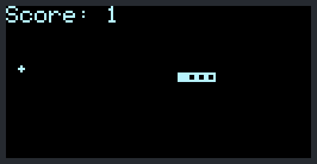<br><sub>Snake</sub></td>
<td align="center">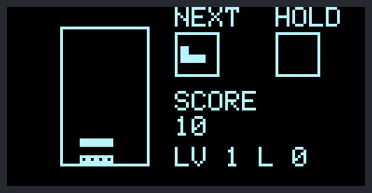<br><sub>Tetris</sub></td>
<td align="center">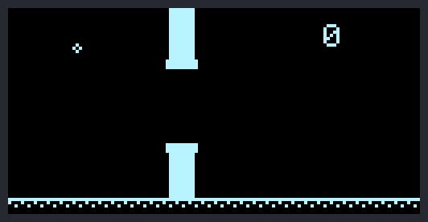<br><sub>Flappy Bird</sub></td>
</tr>
<tr>
<td align="center">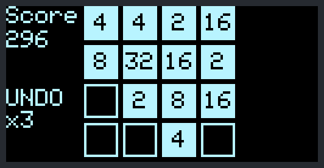<br><sub>2048</sub></td>
<td align="center">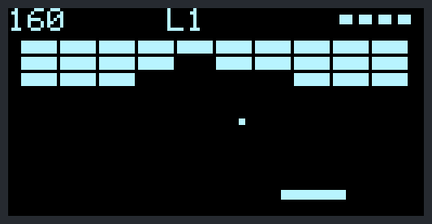<br><sub>Breakout</sub></td>
<td align="center">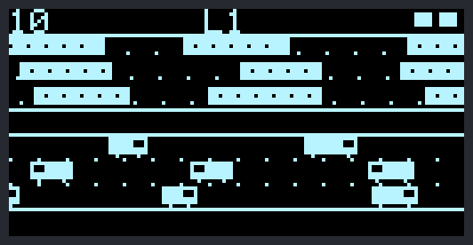<br><sub>Frogger</sub></td>
</tr>
<tr>
<td align="center">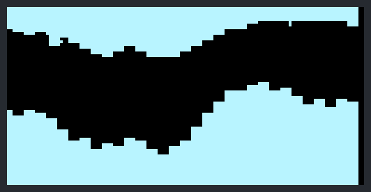<br><sub>Helicopter</sub></td>
<td align="center">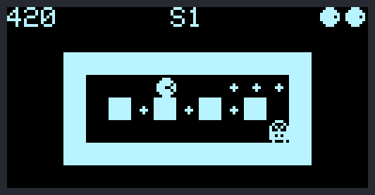<br><sub>Pac-Man</sub></td>
<td align="center">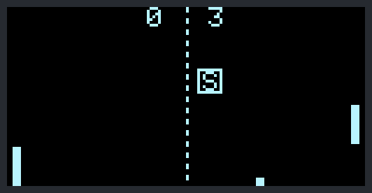<br><sub>Pong (with a power-up)</sub></td>
</tr>
<tr>
<td align="center">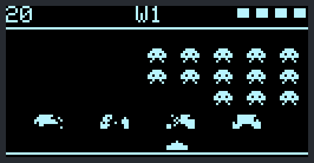<br><sub>Invaders</sub></td>
<td align="center">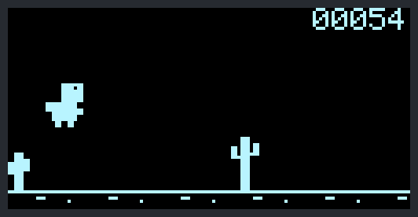<br><sub>Dino</sub></td>
<td align="center">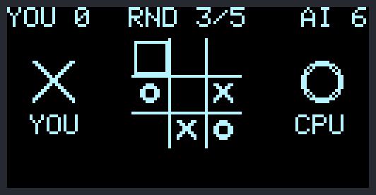<br><sub>Tic-Tac-Toe</sub></td>
</tr>
<tr>
<td align="center">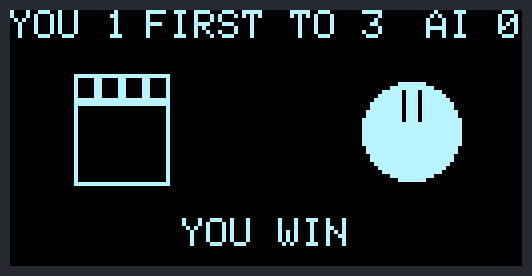<br><sub>Rock Paper Scissors</sub></td>
<td align="center">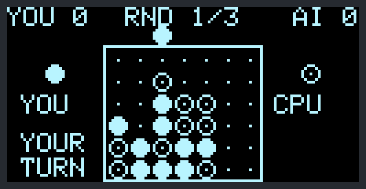<br><sub>Connect 4</sub></td>
</tr>
</table>

| Game | What it has |
|---|---|
| Snake | Five speeds, solid or wrap-around walls, queued turns |
| Tetris | Next piece, hold, ghost piece, wall kicks, hard drop, start level |
| Flappy Bird | Five difficulty levels (gap size and speed) |
| 2048 | 4x4 or 5x5 board, three undos |
| Breakout | Five levels, power-up capsules (wide paddle, multiball, slow ball, extra life) |
| Frogger | Traffic and river logs, three lives, gets faster every crossing |
| Helicopter | Scrolling cave, five difficulty levels |
| Pac-Man | Five mazes from small to full screen, power pellets, ghosts that each hunt differently, three lives |
| Pong | Vs the computer (five AI levels), vs a friend, or practice against a wall. Spin and optional power-ups |
| Invaders | Shields, a bonus ship, waves |
| Dino | Endless runner with day and night |
| Tic-Tac-Toe | Best of five vs the computer (five levels) or a friend |
| Rock Paper Scissors | First to three, vs an AI that learns your habits or a friend |
| Connect 4 | Best of three vs a computer that looks up to ten moves ahead (five levels) or a friend |

## Features

- Settings for each game (difficulty, mode, board size, etc) that get remembered between power-ups
- Two-console play with host and join, short unit IDs, the host can accept or deny, and encrypted packets
- High scores that actually save, with a Wi-Fi backup page to download and restore them
- An animated menu with an icon and best score for every game
- A welcome animation and a short tour on the first boot
- Little screen effects like score pops and shutter wipes
- A manufacturing test mode for checking new units, see [Manufacturing test mode](#manufacturing-test-mode)
- Console-to-console firmware updates over ESP-NOW, no cable or PC needed, see [Console-to-console firmware update](#console-to-console-firmware-update)
- Board built upside down? One setting (`FLIPPED_BUTTONS`) swaps the buttons, and swapped display pins are found on their own
- A PC emulator for Linux, macOS and Windows, and automated tests that run on all three, see [tools/](tools/README.md)
- Ready-made `.bin` files on the [Releases](https://github.com/Simplyph0/PixelBit/releases) page, built and tested automatically

<table>
<tr>
<td align="center">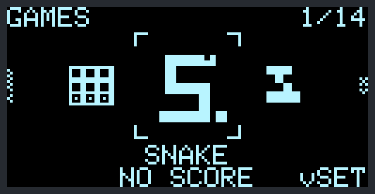<br><sub><code>vSET</code> under the game means it has settings</sub></td>
<td align="center">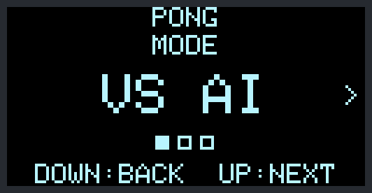<br><sub>One settings screen per option</sub></td>
<td align="center">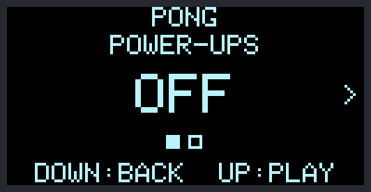<br><sub>Your choices are remembered</sub></td>
</tr>
</table>

## Build it

The full step by step build guide with photos is in **[Instructions.md](Instructions.md)** (also as a [PDF](Instructions.pdf)). If you already know your way around a soldering iron, this is the short version.

### Parts
- ESP8266 D1 Mini
- 0.96" I2C OLED (128x64, SSD1306, address 0x3C)
- 4 push buttons (6x6x5 mm)
- Perforated grid board
- 2 M3 countersunk screws (5 to 10 mm), thin wire, solder

### Wiring

| Part | ESP8266 pin | What it does |
|---|---|---|
| OLED SDA | D2 (GPIO4) | I2C data |
| OLED SCL | D1 (GPIO5) | I2C clock |
| OLED VCC | VIN | 5V power, same as the original build |
| OLED GND | GND | Ground |
| Button Up | D6 (GPIO12) | Input, other side to ground |
| Button Down | D7 (GPIO13) | Input, other side to ground |
| Button Left | D4 (GPIO2) | Input, other side to ground |
| Button Right | D5 (GPIO14) | Input, other side to ground |

Built your board upside down, so every button is in the opposite spot? No need to rewire. Set `FLIPPED_BUTTONS` to `1` in `GameSystem/config.h` and upload again: Up and Down swap pins, and so do Left and Right. It is `0` (the wiring above) by default. If SDA and SCL are swapped, the firmware notices and uses them the other way round.

### Case
The 3D printed case is the original author's design: [Tiny Retro Arcade on MakerWorld](https://makerworld.com/en/models/1526306-tiny-retro-arcade-8-games). It has cutouts for the display and buttons, a USB port, and a snap-fit lid with screws.

## Install the firmware

1. Install the [Arduino IDE](https://www.arduino.cc/en/software/).
2. Add ESP8266 support. Go to File > Preferences and add `http://arduino.esp8266.com/stable/package_esp8266com_index.json` to "Additional Boards Manager URLs". Then install **esp8266** in Tools > Board > Boards Manager.
3. Install **Adafruit SSD1306** and **Adafruit GFX Library** (with their dependencies) from the Library Manager.
4. Open `GameSystem/GameSystem.ino`.
5. **Change `LINK_SECRET` in `GameSystem/config.h` to your own random text.** Two consoles can only play each other if they have the same secret, and it keys the encryption.
6. Pick the board **LOLIN(WEMOS) D1 R2 & mini**, pick your port, and hit Upload.

No IDE? Every release on the [Releases](https://github.com/Simplyph0/PixelBit/releases) page has a ready `.bin`. Flash it with [esptool](https://github.com/espressif/esptool):

```bash
esptool.py --port /dev/ttyUSB0 write_flash 0x0 PixelBit-v4.2.bin
```

The release builds use the `LINK_SECRET` that is in this repo, so they can play and update each other but anyone else's release build can join them too.

Heads up: `LINK_SECRET` is sitting in the source, so anyone with your firmware can read it. It keeps other people and other builds out of your games, but it won't stop someone who has your firmware.

## Using the console

### First boot
A new console plays a welcome animation ("Welcome to your new PixelBit!") and then a short tour. The tour waits for you to actually press each button.

<p align="center">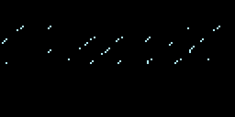<br><sub>The welcome animation</sub></p>

<table>
<tr>
<td align="center">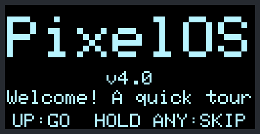<br><sub>Tour start</sub></td>
<td align="center">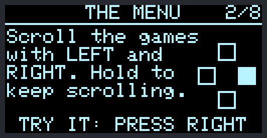<br><sub>Pages wait for you to press the button</sub></td>
<td align="center">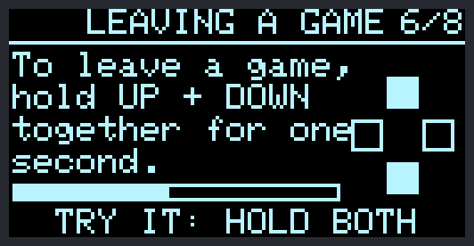<br><sub>You try it for real</sub></td>
</tr>
</table>

It only counts as done when you acknowledge it. That means you either finish the tour, or skip it (hold any button for 1.5 seconds) and close the "TOUR SKIPPED" message with **Up**. If the power gets cut before that, it plays again next boot. Want to see it again later? Hold **Down** on the menu for a second.

### Menu

| Button | What it does |
|---|---|
| Left / Right | Scroll through the games (hold to keep scrolling) |
| Up | Start the selected game |
| Down (tap) | Change that game's settings. Games that have some show `vSET` under the carousel |
| Down (hold) | Replay the tour |

The first time you open a game with settings, you get one screen per setting. **Left/Right** changes it, **Up** goes to the next one, **Down** goes back. After that the game starts right away with your last choices.

### In any game
- Hold **Up + Down** for a second to leave.
- On the result screen, **Up** goes back to the menu and **Right** plays again.

### Controls

| Game | Controls |
|---|---|
| Snake | Arrows turn |
| Tetris | Left/Right move (hold to repeat), Up rotates, Down soft drops (double tap for a hard drop), Left + Right together holds a piece |
| Flappy Bird | Up or Right flaps |
| 2048 | Arrows slide, Left + Right together undo (three per game) |
| Breakout | Left/Right move the paddle, catch the capsules |
| Frogger | Arrows hop |
| Helicopter | Up or Right lifts |
| Pac-Man | Arrows steer |
| Pong | Up/Down move the paddle |
| Invaders | Left/Right move, Up or Down fires |
| Dino | Up or Right jumps, Down ducks |
| Tic-Tac-Toe | Left/Right step through the empty squares, Down jumps a row, Up places your mark |
| Rock Paper Scissors | Left/Right pick a hand, Up locks it in |
| Connect 4 | Left/Right pick a column, Up or Down drops the disc |

## Playing a friend

Pong, Tic-Tac-Toe, Rock Paper Scissors and Connect 4 work between two consoles. No router, no wifi network.

1. On both consoles, open the game and pick **2 PLAYER** in its settings.
2. One console picks **HOST GAME**, the other picks **JOIN GAME**.
3. The joiner sees nearby hosts by their 5 character ID. Pick one with **Left/Right** and press **Up**.
4. The host sees the request. **Up** accepts it, **Down** denies it.

<table>
<tr>
<td align="center">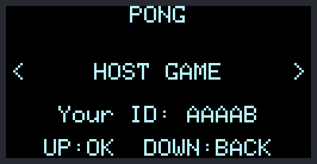<br><sub>Host or join</sub></td>
<td align="center">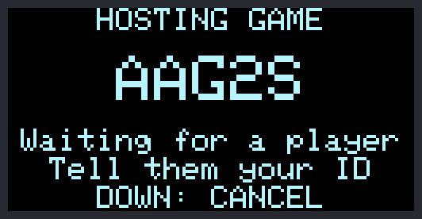<br><sub>The host waits and shows its ID</sub></td>
</tr>
<tr>
<td align="center">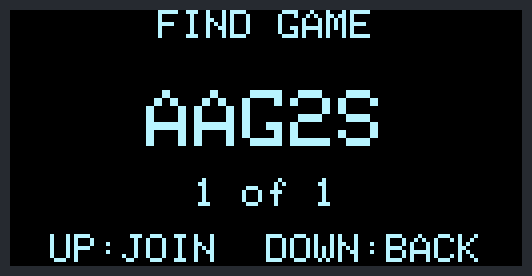<br><sub>The joiner picks a host by ID</sub></td>
<td align="center">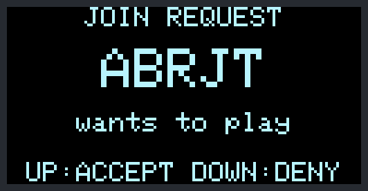<br><sub>The host accepts or denies</sub></td>
</tr>
</table>

Both consoles need the same firmware version and the same `LINK_SECRET`. Each console's ID comes from its chip, and the link uses the full 48 bit hardware address underneath, so two consoles can't get mixed up.

## Saved data

High scores, each game's settings, and the "tour done" flag live in the ESP8266's emulated EEPROM. Everything has a checksum, so if a block gets damaged it just goes back to defaults. A normal firmware upload (or a console-to-console update) keeps your data. Picking "Erase Flash: All Flash Contents" in the Arduino IDE wipes it.

### Backing up your scores
There's a hidden Wi-Fi page for this. On the menu press **Left, Left, Right, Right, Up, Up, Left, Right**, then hold **Up** for two seconds. The console starts its own little Wi-Fi network and shows the name and a random password on screen (both are new every time). Join it with your phone and open `http://192.168.4.1`. From there you can:

- download your scores as a small text file,
- paste or upload one to restore it (keep the best of both, or overwrite),
- erase every score (you have to type RESET first).

Double-tap **Up** to switch it off again. Only one device can join at a time, and the network is gone once it's off. The save file has a checksum, so a damaged or edited one gets refused.

## Manufacturing test mode

This is for checking new units as you build them. Every new console shows the welcome animation and the tour on its first boot, and that only gets saved once the tour is acknowledged:

- you finish the tour (the last page, **Up: Finish**), or
- you skip it (hold any button for 1.5 seconds) and close the "TOUR SKIPPED" message with **Up**.

If the power gets cut during the animation, the tour, or the message, the unit greets its owner again next boot. The regular PixelOS splash only takes over after the tour has been acknowledged.

### Getting in
On the welcome animation or any page of the tour, press **Left three times** (each press within 3 seconds of the last), then **hold Up** for one second.

Test mode never marks the tour as acknowledged and saves nothing, so a tested unit still greets its new owner. Picking **EXIT** restarts the console into a normal first boot.

Buttons the wrong way round? Change `FLIPPED_BUTTONS` in `config.h` and upload again.

### The tests
Move with **Left/Right** and run a test with **Up**. The list shows OK, FAIL, or -- for each one.

<table>
<tr>
<td align="center">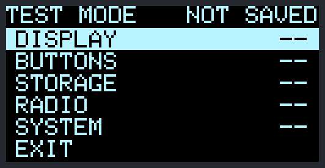<br><sub>The test list</sub></td>
<td align="center">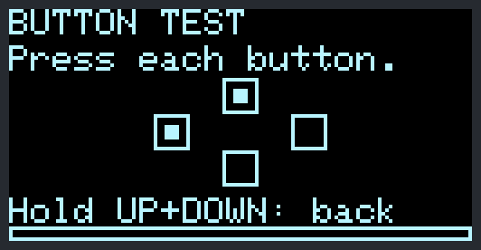<br><sub>Button test</sub></td>
</tr>
<tr>
<td align="center">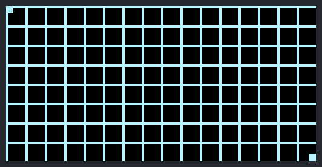<br><sub>Display test pattern</sub></td>
<td align="center">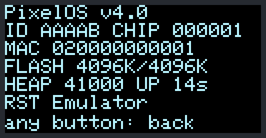<br><sub>System info</sub></td>
</tr>
</table>

| Test | What it does |
|---|---|
| DISPLAY | Full screen patterns: all white, all black, two checkerboards, lines, a border with diagonals, and a grid. **Up/Right** goes to the next one, **Left** goes back, **Down** leaves. It's marked OK once all eight have been shown. Look for dead or stuck pixels |
| BUTTONS | Shows each button live, and a dot stays once a button has been seen. OK when all four have been pressed. Hold **Up + Down** for a second to leave |
| STORAGE | Writes four bit patterns to a scratch area and reads them back from the EEPROM buffer and from the flash chip itself. FAIL shows the first bad byte. It doesn't touch scores or settings |
| RADIO | Starts the radio and scans for other consoles in test mode. **Up** switches between scanning and sending beacons, so two units can find each other (one scans, one beacons). OK once another unit has been seen. Shows the unit's MAC and short ID |
| UPDATE | Send or receive firmware between two consoles, see [Console-to-console firmware update](#console-to-console-firmware-update) |
| SYSTEM | Firmware version, ID, firmware fingerprint, chip ID, MAC, real and configured flash size, free memory, uptime, and the last reset reason. If the flash sizes don't match, you probably have the wrong board setting or a fake chip |

The emulator has the same mode (run it without `--no-tutorial`). There the storage test only checks the memory buffer, and the radio test needs two emulators running with `--udp 0` and `--udp 1` to find anyone.

## Console-to-console firmware update

One console can copy its own firmware to another one over the air (ESP-NOW), so you can update a unit without a cable or a PC. Open test mode on both consoles (hold **Down** on the menu to replay the tour, then **Left three times** and **hold Up**), pick **UPDATE**, then choose **SEND** on one and **RECEIVE** on the other. They pair the same way as the two-console games.

What happens:

1. The sender reads its own flash and works out a SHA-256 hash of its firmware.
2. It offers the version, size, and hash to the receiver.
3. The receiver checks the offer and shows a consent screen. **Up** installs, **Down** denies. Nothing is written until you press Up.
4. The firmware goes over in 192 byte chunks with acknowledgements, a window of 8 chunks in flight, and resends for anything lost. It takes a few seconds to a minute depending on the radio.
5. The receiver hashes what it got and only installs it if the hash matches. Then it restarts.

Version rules: a newer version is offered normally. If the version number is the same, the receiver is told "Same version number as this build" and can still install it (handy for a unit that got a bad flash). An older version is refused.

Safety checks: the image has to fit in the free update space, has to start with a real firmware header, and has to match its hash. The receiver keeps its own flash settings (bytes 2 and 3 of the header) in case the two units have different chips. If anything fails, the link drops, or the sender walks away, the update is thrown away and the old firmware keeps running.

### What the hash looks like
The full SHA-256 is 64 hex characters, for example:

```
9def956fe2d9921e10120fdaa4c10e0d9ae27e5206b14ab07d68c9b4e1936999
```

The screens show the first 8 characters as two groups, so that example is **9DEF 956F**. You see it on the sender, on the receiver's consent screen, and on the test mode SYSTEM page (`FW 9DEF 956F 360K`). If both consoles show the same fingerprint, they have the same firmware.

### Security disclaimer
Read this before you use it. This is a hobby feature, not secure updating.

- The firmware is **not signed**. The hash only proves the file arrived in one piece. It does not prove who made it.
- The pairing secret (`LINK_SECRET` in `config.h`) is in this public repo, so anyone running this code can pair with your console. Radio packets are authenticated per session and numbered so they can't be replayed, but that is not a defence against someone who knows the secret.
- The only real gate is the consent screen. Someone nearby who also has test mode open and picks SEND could offer your console a malicious image, and if you press Up on it, you installed it. Only accept from a console you are looking at.
- The 8 character fingerprint is 32 bits. It is fine for "are these the same build", not for telling a good image from a crafted one. Compare the full hash if you care.
- A power cut in the middle of the final write can still brick a unit. If that happens, reflash over USB.
- Receiving can only happen from test mode, which needs the secret button combo, but that is obscurity, not security.

If you don't want the feature, set `ENABLE_P2P_UPDATE` to `0` in `GameSystem/config.h` and rebuild. The UPDATE item and the code are then left out.

In the emulator, add `--firmware file.bin` to load a real image to send, `--update-out file.bin` for where a received image is saved, and `--free-space N` to pretend the update space is smaller.

## For tinkerers

### What's in the repo

| Folder or file | What it is |
|---|---|
| `GameSystem/` | The firmware. Open `GameSystem.ino` |
| `tools/emulator/` | A PC emulator (Linux, macOS, Windows) that runs the real firmware in a window. Screenshots, GIFs, input recording and replay |
| `tools/tests/` | Automated checks for the game rules, the AIs, two-console play and saved data. Run `ctest --test-dir build/tools` (CMake) or `make test` in there |
| `tools/CMakeLists.txt` | Builds the emulator and the tests on Linux, macOS and Windows |
| `tools/bridge/` | Firmware for an ESP32 board so the emulator can play a real console |
| `Instructions.md`, `Instructions.pdf`, `images/` | The original build guide and photos |
| `.github/workflows/` | Builds, tests and publishes a release for every firmware change |

### How the firmware is laid out
- `gamemanager` runs the menu, the settings screens, the result screens, the tour and the games. Every game is a class that implements the `Game` interface in `game.h`.
- `display`, `input`, `ui`, `fx` and `frame` are the shared screen, button (layout and debouncing), effect and frame timing helpers.
- `gamelink`, `lobby` and `crypto` are the two-console link (ESP-NOW with SHA-256 based pairing and encryption) and the shared host and join screens.
- `highscore` and `settings` handle the saved data, and `savesync` is the Wi-Fi backup page.
- `fwupdate` is the console-to-console firmware update.
- `tutorial`, `welcome` and `testmode` are the first boot stuff and the manufacturing test.

### Adding a game
1. Make a class that implements `Game`. That's init, update, draw, game over, and score. If it has settings, also `optionCount()`, `option()` and `setOption()`.
2. Add its ID to `GameID` and bump `MAX_GAMES` in `config.h`.
3. Add it to the table in `gamemanager.cpp` and give it an icon in `menuicons.cpp`.

### Try it without the hardware
All the screenshots in this README came from the emulator, so you can make the same ones yourself.

```
cmake -S tools -B build/tools && cmake --build build/tools && build/tools/emulator
```
Check [tools/README.md](tools/README.md) for the keys, replay files, and how to run two emulators against each other.

## Troubleshooting

- **Blank display:** check the SDA and SCL wires and the display address (0x3C). Swapped SDA and SCL are found on their own. With `DEBUG_SERIAL` on, the serial monitor says what it found.
- **The buttons are mirrored (Left does Right, Up does Down):** change `FLIPPED_BUTTONS` in `GameSystem/config.h` (0 or 1) and upload again.
- **A button does nothing:** check its wire against the pin table.
- **Upload fails:** check the board and port, and make sure the USB cable can carry data and not just power.
- **Two consoles can't find each other:** both need the new firmware and the same `LINK_SECRET`. Keep them within a few meters, and have the host pick **HOST GAME** first.
- **The tour shows up every time:** it only stops once you acknowledge it (see First boot). If your scores and settings also don't survive a restart, reflash and open an issue.
- **Serial output:** 115200 baud. Set `DEBUG_SERIAL` to 1 in `config.h` for detailed logs. It's off in normal builds because it slows things down and prints the backup page's Wi-Fi password.

## License

GNU General Public License v3.0, see [LICENSE.md](LICENSE.md). The original project and its author are credited at the top. If you build on this, keep those notices and share your changes under the same license.

---

Have fun with it.
