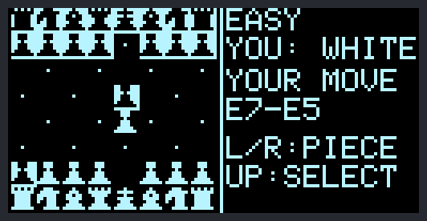
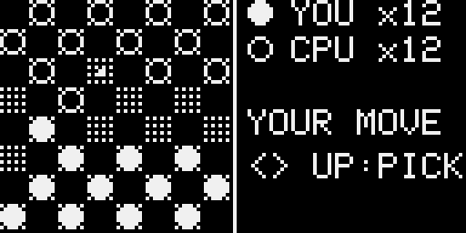
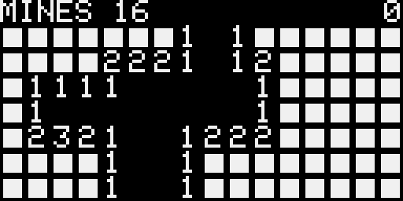
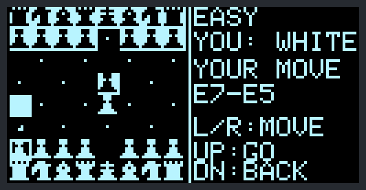
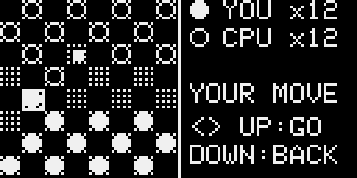

# PixelBit

PixelBit is a pocket handheld arcade: an ESP8266, a tiny OLED screen and four buttons. It has 17 games (including chess, checkers and minesweeper), a video player, chat and a settings menu, and two consoles can play each other with no wifi or router. It runs PixelOS v4.6.


<p align="center"><br><sub>The menu on the OLED (screen capture from the PC emulator)</sub></p>

> ## Credit
> **This is a fork of [Arduino-Game-System](https://github.com/innif/Arduino-Game-System) by Finn Harms ([innif](https://github.com/innif)).** All credit for the hardware, the case, the build instructions and the first eight games goes to them. The case and the original project are on [MakerWorld](https://makerworld.com/en/models/1526306-tiny-retro-arcade-8-games). Go star the [original repo](https://github.com/innif/Arduino-Game-System) and thank them.
>
> **What I added:** seven new games, rewrites of the original eight, a new menu, per-game settings, a first-boot welcome and tour, two-console play, a manufacturing test mode, a PC emulator and automated tests.
>
> **About the AI:** an AI coding assistant (Claude) wrote most of the code in this fork. I told it what to build, tested everything and ran it on a real console. I'd rather you hear that from me.
>
> This is under the **GNU General Public License v3.0**, same as the original. See [LICENSE.md](LICENSE.md).

## Contents

- [Games](#games)
- [Features](#features)
- [Build it](#build-it)
- [Install the firmware](#install-the-firmware)
- [Using the console](#using-the-console)
- [Videos](#videos)
- [Playing a friend](#playing-a-friend)
- [Chat](#chat)
- [Saved data](#saved-data)
- [Manufacturing test mode](#manufacturing-test-mode)
- [Console-to-console firmware update](#console-to-console-firmware-update)
- [For tinkerers](#for-tinkerers)
- [Troubleshooting](#troubleshooting)
- [License](#license)

## Games

<table>
<tr>
<td align="center"><br><sub>Snake</sub></td>
<td align="center"><br><sub>Tetris</sub></td>
<td align="center"><br><sub>Flappy Bird</sub></td>
</tr>
<tr>
<td align="center"><br><sub>2048</sub></td>
<td align="center"><br><sub>Breakout</sub></td>
<td align="center"><br><sub>Frogger</sub></td>
</tr>
<tr>
<td align="center"><br><sub>Helicopter</sub></td>
<td align="center"><br><sub>Pac-Man</sub></td>
<td align="center"><br><sub>Pong (with a power-up)</sub></td>
</tr>
<tr>
<td align="center"><br><sub>Invaders</sub></td>
<td align="center"><br><sub>Dino</sub></td>
<td align="center"><br><sub>Tic-Tac-Toe</sub></td>
</tr>
<tr>
<td align="center"><br><sub>Rock Paper Scissors</sub></td>
<td align="center"><br><sub>Connect 4</sub></td>
<td align="center"><br><sub>Chess</sub></td>
</tr>
<tr>
<td align="center"><br><sub>Checkers</sub></td>
<td align="center"><br><sub>Minesweeper</sub></td>
</tr>
</table>

| Game | What it has |
|---|---|
| Snake | Five speeds, solid or wrap-around walls, queued turns |
| Tetris | Next piece, hold, ghost piece, wall kicks, hard drop, start level |
| Flappy Bird | Five difficulty levels (gap size and speed) |
| 2048 | 4x4 or 5x5 board, three undos |
| Breakout | Five levels, power-up capsules (wide paddle, multiball, slow ball, extra life) |
| Frogger | Traffic and river logs, three lives, gets faster every crossing |
| Helicopter | Scrolling cave, five difficulty levels |
| Pac-Man | Five mazes from small to full screen, power pellets, ghosts that each hunt differently, three lives |
| Pong | Vs the computer (five AI levels), vs a friend, or practice against a wall. Spin and optional power-ups |
| Invaders | Shields, a bonus ship, waves |
| Dino | Endless runner with day and night |
| Tic-Tac-Toe | Best of five vs the computer (five levels: EASY plays at random, each step is a small one, only INSANE never loses) or a friend |
| Rock Paper Scissors | First to three, vs an AI that learns your habits or a friend |
| Connect 4 | Best of three vs a computer that looks up to ten moves ahead (five levels) or a friend |
| Chess | The full rules, vs a computer with five levels (VERY EASY, almost random, to SUPER HARD, five seconds a move) or a friend. See [Chess](#chess) |
| Checkers | English draughts with compulsory captures and multiple jumps, vs a computer with five levels (VERY EASY, random, to SUPER HARD, four seconds a move) or a friend. See [Checkers](#checkers) |
| Minesweeper | 16 x 7 field, five levels (12 to 30 mines), the first cell is always safe, flags and chords. See [Minesweeper](#minesweeper) |

## Features

- Per-game settings (difficulty, mode, board size...) remembered between power-ups
- Two-console play: host and join, short unit IDs, accept or deny, encrypted packets
- High scores that save, with a Wi-Fi page (from SETTINGS) to download and restore them and to name your friends' consoles
- An animated menu with an icon and best score for every game, screen effects, and a welcome animation and tour on first boot
- Chess and Checkers with five AI levels or a friend, see [Chess](#chess) and [Checkers](#checkers)
- Chat: ready-made messages ("Let's play Pong", "Good game!") over ESP-NOW, with a notification blip over whatever you are doing, see [Chat](#chat)
- A settings menu: brightness, screen-off timer, chat on/off, Wi-Fi page, firmware update, resets, intro and about, see [Settings](#settings)
- Console-to-console firmware updates over ESP-NOW, no cable or PC, see [Console-to-console firmware update](#console-to-console-firmware-update)
- A video player: black and white clips, no sound, uploaded over Wi-Fi, see [Videos](#videos)
- A manufacturing test mode for new units, see [Manufacturing test mode](#manufacturing-test-mode)
- Board built upside down? `FLIPPED_BUTTONS` swaps the buttons, and swapped display pins are found on their own
- A one-page printable [quick start](docs/PixelBit-QuickStart.pdf) for new owners
- A PC emulator and automated tests for Linux, macOS and Windows, see [tools/](tools/README.md)
- Ready-made `.bin` files on the [Releases](https://github.com/Simplyph0/PixelBit/releases) page, built and tested automatically

<table>
<tr>
<td align="center"><br><sub><code>vSET</code> under the game means it has settings</sub></td>
<td align="center"><br><sub>One settings screen per option</sub></td>
<td align="center"><br><sub>Your choices are remembered</sub></td>
</tr>
</table>

## Build it

The full guide with photos is **[Instructions.md](Instructions.md)** ([PDF](Instructions.pdf)). This is the short version.

### Parts
- ESP8266 D1 Mini
- 0.96" I2C OLED (128x64, SSD1306, address 0x3C)
- 4 push buttons (6x6x5 mm)
- Perforated grid board
- 2 M3 countersunk screws (5 to 10 mm), thin wire, solder

### Wiring

| Part | ESP8266 pin | What it does |
|---|---|---|
| OLED SDA | D2 (GPIO4) | I2C data |
| OLED SCL | D1 (GPIO5) | I2C clock |
| OLED VCC | VIN | 5V power, same as the original build |
| OLED GND | GND | Ground |
| Button Up | D6 (GPIO12) | Input, other side to ground |
| Button Down | D7 (GPIO13) | Input, other side to ground |
| Button Left | D4 (GPIO2) | Input, other side to ground |
| Button Right | D5 (GPIO14) | Input, other side to ground |

Built it upside down, so every button is in the opposite spot? No need to rewire: flash the `-flipped` `.bin` from Releases, or set `FLIPPED_BUTTONS` to `1` in `GameSystem/config.h` and upload again (Up/Down and Left/Right swap pins). The default is `0`, the wiring above. Swapped SDA and SCL are noticed and used the other way round.

### Case
The 3D printed case is the original author's design: [Tiny Retro Arcade on MakerWorld](https://makerworld.com/en/models/1526306-tiny-retro-arcade-8-games), with cutouts for the display, buttons and USB port and a snap-fit lid with screws.

## Install the firmware

1. Install the [Arduino IDE](https://www.arduino.cc/en/software/).
2. Add ESP8266 support. Go to File > Preferences and add `http://arduino.esp8266.com/stable/package_esp8266com_index.json` to "Additional Boards Manager URLs". Then install **esp8266** in Tools > Board > Boards Manager.
3. Install **Adafruit SSD1306** and **Adafruit GFX Library** (with their dependencies) from the Library Manager.
4. Open `GameSystem/GameSystem.ino`.
5. **Change `LINK_SECRET` in `GameSystem/config.h` to your own random text.** Two consoles can only play each other if they have the same secret, and it keys the encryption.
6. Pick the board **LOLIN(WEMOS) D1 R2 & mini**, pick your port, and hit Upload.
   Leave **Tools > Flash Size** at the default, `4MB (FS:2MB OTA:~1019KB)`: videos live in that 2 MB file system and the ready-made `.bin` files use it. A smaller flash runs everything but the video player. Use the same setting on every console you update from or to, because an update that moves the file system erases the videos.

No IDE? Every release on the [Releases](https://github.com/Simplyph0/PixelBit/releases) page has a ready `.bin`. Flash it with [esptool](https://github.com/espressif/esptool):

```bash
esptool.py --port /dev/ttyUSB0 write_flash 0x0 PixelBit-v4.6.bin
```

Prefer clicking? `tools/flasher/pixelbit_flasher.py` is a small window for Linux, macOS and Windows: pick the `.bin`, it finds the console's port, flashes at 460800 baud and can flash several consoles at once. Chip erase is off by default because it deletes scores and videos. Needs Python 3 with tkinter and esptool (`pipx install esptool`). See [tools/](tools/README.md).

Each release has `PixelBit-<version>.bin` for a board wired as above and `PixelBit-<version>-flipped.bin` for one built upside down (the same firmware with `FLIPPED_BUTTONS` at 0 and 1).

Release builds use the `LINK_SECRET` in this repo, so they can play and update each other, but so can anyone else's release build. `LINK_SECRET` is in the source, so anyone with your firmware can read it: it keeps other people and builds out of your games, not people who hold your firmware.

## Using the console

New? Print the one-page black and white **[quick start](docs/PixelBit-QuickStart.pdf)**: buttons, two-console games, chat, the Wi-Fi page, videos, settings, console-to-console updates and what to try when something is wrong.

### First boot
A new console plays a welcome animation and then a short tour that waits for you to press each button.

<p align="center"><br><sub>The welcome animation</sub></p>

<table>
<tr>
<td align="center"><br><sub>Tour start</sub></td>
<td align="center"><br><sub>Pages wait for you to press the button</sub></td>
<td align="center"><br><sub>You try it for real</sub></td>
</tr>
</table>

It counts as done once you finish the tour, or skip it (hold any button 1.5 seconds) and close "TOUR SKIPPED" with **Up**. If the power is cut before that, it plays again next boot. To replay it, hold **Down** on the menu for a second.

### Menu

| Button | What it does |
|---|---|
| Left / Right | Scroll through the games (hold to keep scrolling) |
| Up | Start the selected game |
| Down (tap) | Change that game's settings. Games that have some show `vSET` under the carousel |
| Down (hold) | Replay the tour |

The first time you open a game with settings you get one screen per setting: **Left/Right** changes it, **Up** goes on, **Down** goes back. After that the game starts at once with your last choices.

### Settings
The last tile, **SETTINGS**, holds what needs neither a computer nor typing (that stays on the Wi-Fi page). **Up/Down** scroll, **Right** changes or opens an entry, **Left** goes back.

| Entry | What it does |
|---|---|
| BRIGHTNESS | Five steps, applied at once and kept. HIGH is the usual brightness |
| SCREEN OFF | Turns the screen off after 1, 2 or 5 minutes without a button (NEVER by default). Any button wakes it and does nothing else. It stays on during videos, updates and the Wi-Fi pages |
| CHAT | `ON` (default) keeps the radio listening so messages reach you while you play, see [Chat](#chat). `OFF` saves a little power; the console is deaf until you open the CHAT tile |
| WI-FI PAGE | Starts a private Wi-Fi network and shows its name, a random password and the address. Join it for the save backup and chat contacts, see [Backing up your scores](#backing-up-your-scores). **Left** stops it |
| UPDATE FIRMWARE | Send or receive firmware between two consoles, see [Console-to-console firmware update](#console-to-console-firmware-update) |
| RESET SCORES | Erases every high score. Hold **Right** for 2 seconds to confirm |
| RESET OPTIONS | Every game forgets its remembered settings and asks again. Same confirmation |
| SHOW INTRO | Plays the welcome animation and tour again on the next boot (clears only the "tour seen" flag) |
| FACTORY RESET | Back to a new console: erases scores, game settings, brightness, screen off, chat settings, contacts and all videos, then restarts into the welcome animation. Hold **Right** 3 seconds to confirm |
| ABOUT | Version, this console's id (as shown in chat and two-console games), build date, button layout, free memory |

### In any game
- Hold **Up + Down** for a second to leave.
- On the result screen, **Up** goes back to the menu and **Right** plays again.

### Controls

| Game | Controls |
|---|---|
| Snake | Arrows turn |
| Tetris | Left/Right move (hold to repeat), Up rotates, Down soft drops (double tap for a hard drop), Left + Right together holds a piece |
| Flappy Bird | Up or Right flaps |
| 2048 | Arrows slide, Left + Right together undo (three per game) |
| Breakout | Left/Right move the paddle, catch the capsules |
| Frogger | Arrows hop |
| Helicopter | Up or Right lifts |
| Pac-Man | Arrows steer |
| Pong | Up/Down move the paddle |
| Invaders | Left/Right move, Up or Down fires |
| Dino | Up or Right jumps, Down ducks |
| Tic-Tac-Toe | Left/Right step through the empty squares, Down jumps a row, Up places your mark |
| Rock Paper Scissors | Left/Right pick a hand, Up locks it in |
| Connect 4 | Left/Right pick a column, Up or Down drops the disc |
| Chess | Left/Right step through the pieces that can move, Up picks, Left/Right step through destinations, Up moves, Down goes back |
| Checkers | Left/Right step through the pieces that can move (a capture is compulsory), Up picks, Left/Right step through destinations, Up moves, Down goes back |
| Minesweeper | Left/Right move the cursor along the rows (hold to run), Up opens a cell, Down flags it |

### Chess

Chess is the tile after Connect 4 and plays the full rules: castling, en passant, promotion, check, checkmate, stalemate, and draws by three-fold repetition, 50 moves without a capture or pawn move, too few pieces, or a game past 400 half moves.

<table>
<tr>
<td align="center"><br><sub>Playing White; the computer has answered e4 with e5</sub></td>
<td align="center"><br><sub>Choosing where a pawn goes</sub></td>
</tr>
</table>

**Moving.** With four buttons there is no cursor: **Left/Right** step through the pieces that can move (the square flashes), **Up** picks one, **Left/Right** step through where it can go (a dot is a move, corner ticks are a capture), **Up** moves and **Down** goes back. A pawn on the last rank asks what it becomes: queen, rook, bishop or knight. White pieces are drawn light and Black pieces dark on a lit square, so they differ by colour as well as shape; your side is always at the bottom. A flashing frame around a king is check. The side panel shows whose move it is and the last move, like `E7-E5`.

**Pieces.** The **PIECES** setting picks `SHAPES` (little pictures) or `LETTERS` (P N B R Q K) if the pictures are hard to tell apart on your screen.

**Against the computer.** Pick **MODE: VS AI** and a **DIFFICULTY**. You are White in the first game; the sides swap each time you play again.

| Level | How it plays |
|---|---|
| VERY EASY | Moves at random, now and then grabbing the biggest piece it sees, even when that is a mistake |
| EASY | Looks one move ahead; about one move in eight is random |
| MEDIUM | Looks two moves ahead, rarely careless |
| HARD | Four moves ahead, up to 1.5 seconds a move |
| SUPER HARD | As far ahead as it gets in five seconds a move |

The menu score is 3 points for a win or 1 for a draw, times the level (1 to 5), so harder levels are worth more.

**Against a friend.** Pick **2 PLAYER** on both consoles, then HOST GAME and JOIN GAME as in [Playing a friend](#playing-a-friend). The host is White first. After a game, press **Right** on both for a rematch with the sides swapped, or **Up** to leave. The host checks every move the joiner asks for, and a lost move is simply sent again.

### Checkers

Checkers (English draughts) is the tile after Chess: 8 x 8 board, men move diagonally forward, kings both ways, a capture is **compulsory**, a piece that can jump again must keep jumping, a man that reaches the far row becomes a king and its move ends. You lose when you cannot move, and a game with 40 moves each and no capture or man's move is a draw. Your discs are solid, the other side's are rings, a king has a dot in the middle, and a mark shows the square the last piece left.

<table>
<tr>
<td align="center"><br><sub>Your move</sub></td>
<td align="center"><br><sub>Choosing where a piece goes</sub></td>
</tr>
</table>

**Moving.** Like chess: **Left/Right** step through the pieces that can move (only the ones that can jump, when a capture is on offer), **Up** picks one, **Left/Right** step through where it can go (the target flashes), **Up** moves, **Down** goes back. After a jump that can go on, the same piece is picked for you and you choose the next jump.

**Against the computer.** Pick **MODE: VS AI** and a **DIFFICULTY**: VERY EASY plays random moves, EASY looks two moves ahead (and is often careless), MEDIUM four, HARD seven, SUPER HARD as far as it gets in four seconds. You start at the bottom and move first; the sides swap each time you play again. The menu score is 3 points for a win or 1 for a draw, times the level.

**Against a friend.** **2 PLAYER** on both consoles, then HOST GAME and JOIN GAME. The host decides and sends the whole position every frame; the joiner asks for its step until the position shows it. **Right** on both is a rematch with the sides swapped.

### Minesweeper

Open every cell without a mine. A number says how many mines touch the cell; an empty cell opens its neighbours. The field is 16 x 7, with 12, 16, 20, 25 or 30 mines by **DIFFICULTY**, and your first cell is always safe (the mines are placed after it). **Left/Right** move the cursor along the rows (hold to run), **Up** opens a cell, or, on an open number that has as many flags around it, opens the cells around it, **Down** puts a flag or takes it away. The top line counts mines left (flags can be wrong) and the seconds. The score is the cells you opened plus 100 for clearing the field, times the level.


## Videos

The last menu entry, **VIDEOS**, plays black and white videos with no sound. A console ships with one demo clip; you add more over Wi-Fi.

| Where | Button | What it does |
|---|---|---|
| Clip list | Up / Down | Scroll through the clips |
| Clip list | Right | Play it (the last entry, **+ UPLOAD VIDEOS**, opens the upload page) |
| Clip list | Left | Leave the player |
| Playing | Up | Pause and resume |
| Playing | Left / Right | Jump back or forward 5 seconds |
| Playing | Down | Back to the clip list |

There are no loop or speed settings; a finished clip returns you to the list.

### Making a video
Videos are `.pbv` files made with [`tools/video/pbv.py`](tools/video/pbv.py) on Windows, macOS or Linux. It needs Python 3 and [ffmpeg](https://ffmpeg.org/download.html) (on the PATH, or `pip install imageio-ffmpeg`).

```bash
python3 tools/video/pbv.py movie.mp4 --pixel 2 --fps 12
```

That writes `movie.pbv`. GIFs, animated WebP and APNG work too (transparent parts show black; `--background white` for white). The screen is only 128x64, so **`--pixel`** trades detail for visibility:

| `--pixel` | Video size | Good for |
|---|---|---|
| 1 | 128x64 | The most detail and the biggest files. Fine lines get hard to read on a 0.96" screen |
| 2 | 64x32 | A good middle: a quarter of the data, easy to follow |
| 3 | 42x21 | Chunky, small files |
| 4 | 32x16 | The chunkiest and tiniest: clear from across a desk |

Other options: `--fps` (1 to 30, default 15; the console shows about 20 at most), `--dither bayer|threshold|floyd` (`threshold` keeps hard edges for line art, `floyd` is finest), `--threshold`, `--contrast`, `--brightness`, `--invert`, `--background black|white`, `--fit letterbox|crop|stretch`, `--start`, `--duration`. `--help` lists them all and `--demo` makes a test pattern. The converter warns if a clip will not fit: a console has about 1.9 MB for up to 16 videos.

### Putting it on the console
1. Open **VIDEOS**, go to **+ UPLOAD VIDEOS** and press **Right**. The console starts its own Wi-Fi network and shows the name and a random password (new each time).
2. Join it with a phone or computer and open `http://192.168.4.1`.
3. Pick the `.pbv` file and press **Upload** (the console screen freezes meanwhile). The same page lists and deletes clips.
4. Press **Left** on the console to stop the upload page.

### The clip in the firmware
Every console has one clip inside the firmware, [`GameSystem/demo_clip.h`](GameSystem/demo_clip.h), so a fresh (or console-updated) unit has something to play. It is copied into the file system when the player first opens and not again after you delete it. This repo's is a small test pattern. To ship your own, make a header and rebuild:

```bash
python3 tools/video/pbv.py movie.mp4 --pixel 2 --fps 10 --embed GameSystem/demo_clip.h
```

Keep it around 150 KB: it grows the firmware and every console-to-console update. The converter warns above 200 KB.

## Playing a friend

Pong, Tic-Tac-Toe, Rock Paper Scissors, Connect 4, Chess and Checkers work between two consoles, with no router or wifi network.

1. On both consoles, open the game and pick **2 PLAYER** in its settings.
2. One console picks **HOST GAME**, the other picks **JOIN GAME**.
3. The joiner sees nearby hosts by their 5 character ID. Pick one with **Left/Right** and press **Up**.
4. The host sees the request. **Up** accepts it, **Down** denies it.

<table>
<tr>
<td align="center"><br><sub>Host or join</sub></td>
<td align="center"><br><sub>The host waits and shows its ID</sub></td>
</tr>
<tr>
<td align="center"><br><sub>The joiner picks a host by ID</sub></td>
<td align="center"><br><sub>The host accepts or denies</sub></td>
</tr>
</table>

Both consoles need the same firmware version and `LINK_SECRET`. A console's ID comes from its chip, and the link uses the full 48 bit hardware address, so consoles can't get mixed up.

## Chat

The **CHAT** tile (after VIDEOS) sends ready-made messages to another console over the two-console radio, with no Wi-Fi network or router. Both consoles need this firmware.

- **NEW MESSAGE** asks who is in range, then who to send to: **EVERYONE**, a saved contact, or a console that just answered (marked `NEAR`, shown by its 5-letter id). Then pick the message: `LET'S PLAY...` (and the game, taken from the game list, so new games show up by themselves), `BEAT MY SCORE...` (your best score in that game goes along), `WANNA PLAY?`, `REMATCH?`, `GOOD GAME!`, `NICE ONE!`, `YES!`, `NO THANKS`, `MAYBE LATER`, `GIVE ME A MINUTE`, `HELLO!` and `BYE!`.
- A message to one console says **DELIVERED**, or **NO REPLY** if it did not answer (out of range, chat OFF or busy with the Wi-Fi pages). A message to everyone says **SENT**.
- **INBOX** keeps the last 8 messages. **Up/Down** moves to the next one, **Right** answers the sender.
- A round **blip** flashes in the top right corner, over any game, menu or video, when a message arrives and stays until read. It is drawn when the screen is presented, so no game has to know about it.
- **Names.** Consoles show as their 5 letter id (as in the two-console games); yours is on the CHAT screen and in SETTINGS > ABOUT. Add contacts on SETTINGS > WI-FI PAGE (see [Backing up your scores](#backing-up-your-scores)): type the id and a name of 1 to 10 characters (letters, digits, space and `- _ . ! ? + *`). Up to 8 contacts, kept in the EEPROM.

Messages are broadcast and checked with the link secret, so only consoles with the same `LINK_SECRET` take part. They are **not encrypted**: anyone in range with the same firmware can read them, which is fine for "Good game!". Listening costs some battery; turn the radio off with **SETTINGS > CHAT > OFF**.

## Saved data

High scores, game settings, brightness, screen-off and chat settings, chat contacts and the "tour done" flag live in the ESP8266's emulated EEPROM. Each block has a checksum and goes back to defaults if damaged. A normal upload or console-to-console update keeps your data; "Erase Flash: All Flash Contents" in the Arduino IDE wipes it.

### Backing up your scores
Open **SETTINGS > WI-FI PAGE**. The console starts its own Wi-Fi network and shows the name and a random password (new each time). Join it with your phone and open `http://192.168.4.1` to:

- download your scores as a small text file,
- paste or upload one to restore it (keep the best of both, or overwrite),
- keep your **chat contacts** (an id and a name, see [Chat](#chat)),
- erase every score (type RESET first).

Press **Left** on the console to switch it off. One device can join at a time. The save file has a checksum, so a damaged or edited one is refused.

## Manufacturing test mode

For checking new units as you build them. A new console shows the welcome animation and tour on first boot, and that is saved only once you finish the tour (last page, **Up: Finish**) or skip it (hold any button 1.5 seconds) and close "TOUR SKIPPED" with **Up**. If power is cut before that, the unit greets its owner again next boot. The regular PixelOS splash takes over only after that.

### Getting in
On the welcome animation or any tour page, press **Left three times** (each within 3 seconds of the last), then **hold Up** for one second.

Test mode saves nothing and never marks the tour done, so a tested unit still greets its owner. **EXIT** restarts into a normal first boot. Buttons the wrong way round? Change `FLIPPED_BUTTONS` in `config.h`.

### The tests
**Up/Down** scroll, **Right** runs a test, **Left** leaves test mode. The list shows OK, FAIL or -- for each.

<table>
<tr>
<td align="center"><br><sub>The test list</sub></td>
<td align="center"><br><sub>Button test</sub></td>
</tr>
<tr>
<td align="center"><br><sub>Display test pattern</sub></td>
<td align="center"><br><sub>System info</sub></td>
</tr>
</table>

| Test | What it does |
|---|---|
| DISPLAY | Full screen patterns: all white, all black, two checkerboards, lines, a border with diagonals, a grid. **Up/Right** next, **Left** back, **Down** leaves. OK once all eight have been shown. Look for dead or stuck pixels |
| BUTTONS | Shows each button live; a dot stays once seen. OK when all four were pressed. Hold **Up + Down** a second to leave |
| STORAGE | Writes four bit patterns to a scratch area and reads them back from the EEPROM buffer and the flash chip. FAIL shows the first bad byte. Scores and settings are untouched |
| RADIO | Scans for other consoles in test mode. **Up** switches between scanning and sending beacons (one unit each). OK once another unit was seen. Shows the MAC and short ID |
| SYSTEM | Version, ID, firmware fingerprint, chip ID, MAC, real and configured flash size, free memory, uptime, last reset reason. Mismatched flash sizes mean a wrong board setting or a fake chip |

The emulator has the same mode (run it without `--no-tutorial`); there STORAGE checks only the memory buffer, and RADIO needs two emulators with `--udp 0` and `--udp 1`.

## Console-to-console firmware update

One console can copy its firmware to another over ESP-NOW, with no cable or PC. On both open **SETTINGS > UPDATE FIRMWARE**, then pick **SEND** on one and **RECEIVE** on the other. They pair as in the two-console games.

What happens:

1. The sender hashes its own firmware (SHA-256) and offers the version, size and hash.
2. The receiver checks the offer and shows a consent screen: **Up** installs, **Down** denies. Nothing is written before Up.
3. The firmware goes over in 192 byte chunks, 8 in flight, with acknowledgements and resends. A 470 KB firmware took about 10 seconds on two real consoles; a poor link can take up to a minute.
4. The receiver hashes what it got, installs only if the hash matches, then restarts.

Versions: a newer one is offered normally; the same number shows "Same version number as this build" and can still be installed (handy after a bad flash); an older one is refused.

The button layout is part of the firmware, so a console copies its sender's layout. Update between consoles built the same way round (or from a matching `.bin`), or the buttons come out mirrored.

Checks: the image must fit the free update space, start with a real firmware header and match its hash. The receiver keeps its own flash settings (header bytes 2 and 3) in case the chips differ. If anything fails, the link drops or the sender leaves, the update is discarded and the old firmware keeps running.

### If an update fails
A failed update never changes the receiver. The failure screen says why and, for a stall, shows how far it got in the line above `UP: OK`. Press **Up** to leave.

| Screen | Where | What it means |
|---|---|---|
| `TRANSFER STALLED` with `tx12 ack3 lost9` | Sender | Nothing moved for 10 seconds. `tx` is how many chunk packets it sent (repeats included), `ack` how many acknowledgements came back, `lost` how many packets the radio said the other console did not get. `ack0` with a high `lost` means the receiver is not hearing the sender; `ack0` with `lost0` means the sender's packets seem to be delivered but nothing answers |
| `TRANSFER STALLED` with `got 40 bad 0 at 38` | Receiver | `got` is how many chunk packets arrived, `bad` how many of them were not what the offer described, and `at` is the chunk it has written up to. `got0` means nothing reached it |
| `CANNOT START` with `updater error 2` | Receiver | The updater refused to open space for the image: usually not enough free update space, or a flash size set wrongly. The number is the updater's own error code |
| `UPDATE FAILED`, `Writing the image failed.`, with `chunk 12, error 3` | Receiver | Writing to the flash chip failed at that chunk |
| `UPDATE FAILED`, `did not match its checksum` | Both | The image arrived damaged. Try again, closer together |
| `REFUSED` | Sender | The receiver already has a newer version, has no room for the image, or is busy |
| `DENIED`, `CANCELLED` | Sender | The receiver pressed Down, or you cancelled |
| `NO ANSWER` | Sender | The receiver did not press Up within 40 seconds |
| `CONNECTION LOST`, `OTHER CONSOLE LEFT` | Either | The link dropped or the other console left test mode. Keep them within a few meters |
| `NO CONFIRMATION` | Sender | Everything was sent but no result came back; check the receiver, it may have installed and restarted already |

If you still cannot tell why, build both consoles with `UPDATE_DEBUG` set to 1 (`#define UPDATE_DEBUG 0` in `GameSystem/config.h`, or `-DUPDATE_DEBUG=1`), open the serial monitor on each at 115200 baud and retry. The update and link then log every step (offer, accept, first chunks, every 100th chunk, each dropped packet and why, radio and updater errors) and a crash prints its stack trace. It is off in normal builds.

### What the hash looks like
The full SHA-256 is 64 hex characters, e.g.:

```
9def956fe2d9921e10120fdaa4c10e0d9ae27e5206b14ab07d68c9b4e1936999
```

Screens show the first 8 as two groups, so that is **9DEF 956F**, on the sender, the receiver's consent screen and the test mode SYSTEM page (`FW 9DEF 956F 360K`). The same fingerprint means the same firmware.

### Security disclaimer
This is a hobby feature, not secure updating.

- The firmware is **not signed**. The hash proves the file arrived intact, not who made it.
- `LINK_SECRET` is in this public repo, so anyone running this code can pair with your console. Packets are authenticated per session and numbered against replay, which does not help against someone who knows the secret.
- The only real gate is the consent screen. Someone nearby can pick SEND and offer a malicious image; if you press Up, you installed it. Only accept from a console you are looking at.
- The 8 character fingerprint is 32 bits: fine for "same build?", not for spotting a crafted image. Compare the full hash if you care.
- A power cut during the final write can brick a unit; reflash over USB.
- Anyone holding your console can open its receive screen, but it installs only after Up on the consent screen.

To leave the feature out (the UPDATE FIRMWARE entry and its code), set `ENABLE_P2P_UPDATE` to `0` in `GameSystem/config.h` and rebuild.

In the emulator, `--firmware file.bin` loads a real image to send, `--update-out file.bin` saves a received one and `--free-space N` pretends the update space is smaller.

## For tinkerers

### What's in the repo

| Folder or file | What it is |
|---|---|
| `GameSystem/` | The firmware. Open `GameSystem.ino` |
| `tools/video/` | `pbv.py`, the converter that turns a video into a `.pbv` for the video player |
| `docs/` | `PixelBit-QuickStart.pdf`, the one-page printable guide, and `make_quickstart.py` (needs LibreOffice) that rebuilds it from the emulator screenshots in `docs/screens/` |
| `tools/emulator/` | A PC emulator (Linux, macOS, Windows) that runs the real firmware in a window, with screenshots, GIFs, input recording and replay |
| `tools/tests/` | Automated checks for game rules, AIs, two-console play and saved data. Run `ctest --test-dir build/tools -j 3` or `make test` in there |
| `tools/CMakeLists.txt` | Builds the emulator and tests on Linux, macOS and Windows. The firmware sources are compiled once and shared by all of them |
| `tools/bridge/` | Firmware for an ESP32 board so the emulator can play a real console |
| `Instructions.md`, `Instructions.pdf`, `images/` | The original build guide and photos |
| `.github/workflows/` | Tests (three systems) and compiles the firmware side by side, then publishes a release for every firmware change |

### How the firmware is laid out
- `gamemanager` runs the menu, the settings screens, the result screens, the tour and the games. Every game is a class that implements the `Game` interface in `game.h`.
- `display`, `input`, `ui`, `fx` and `frame` are the shared screen, button (layout, debouncing), effect and frame timing helpers.
- `gamelink`, `lobby` and `crypto` are the two-console link (ESP-NOW with SHA-256 based pairing and encryption) and the shared host and join screens. `GameLink::poll()` ignores a call made while it is running, so a packet handler can wait for the radio (`yield()` and `poll()`) without handling the next packet from inside itself and piling up stack.
- `highscore` and `settings` handle the saved data, and `savesync` is the Wi-Fi backup page.
- `fwupdate` is the console-to-console firmware update.
- `chess` is the game and `chessengine` its rules and search. The engine has no Arduino code, so the PC tests run the very same code, checked against the standard perft counts (legal move sequences from known positions), the usual proof of a move generator.
- `checkers` and `checkersengine` are the same split for checkers (the engine plays one step at a time, so a multiple jump is a few steps by the same piece; perft to depth 8 matches the known counts), and `mines` holds the Minesweeper rules, which `minesweeper` draws.
- `settingsmenu` is the SETTINGS tile (a `Game` like the others) and `device` keeps its brightness, screen-off and chat settings in the EEPROM.
- `chat` is the chat protocol, inbox and radio keep-alive, `chatmenu` is the CHAT tile and `contacts` keeps the aliases. `GameLink` carries chat packets in every state; `updateDisplay()` draws the notification blip.
- `videoplayer` and `pbvcodec` are the video player and its file format; the player stores clips in the flash file system (LittleFS).
- `tutorial`, `welcome` and `testmode` are the first boot stuff and the manufacturing test.

### Adding a game
1. Make a class that implements `Game`: init, update, draw, game over and score, plus `optionCount()`, `option()` and `setOption()` for settings.
2. Add its ID to `GameID` and bump `MAX_GAMES` in `config.h`. A game with no score (like the video player) overrides `hasScore()` to return `false`.
3. Add it to the table in `gamemanager.cpp` and give it an icon in `menuicons.cpp`.

### Try it without the hardware
Every screenshot here came from the emulator, so you can make the same ones.

```
cmake -S tools -B build/tools && cmake --build build/tools && build/tools/emulator
```
[tools/README.md](tools/README.md) has the keys, replay files and how to run two emulators against each other.

## Troubleshooting

- **Blank display:** check the SDA and SCL wires and the display address (0x3C). Swapped SDA and SCL are found on their own; with `DEBUG_SERIAL` on, the serial monitor says what it found.
- **Buttons mirrored (Left does Right, Up does Down):** flip `FLIPPED_BUTTONS` in `GameSystem/config.h` (0 or 1) and upload again.
- **A button does nothing:** check its wire against the pin table.
- **Upload fails:** check the board and port, and that the USB cable carries data, not just power.
- **Two consoles can't find each other:** both need the same firmware and `LINK_SECRET`, within a few meters, with the host on **HOST GAME** first.
- **The tour shows every time:** it stops once acknowledged (see First boot). If scores and settings also don't survive a restart, reflash and open an issue.
- **A console-to-console update sticks at 0% and the receiver restarts with its old firmware:** older firmware crashed the receiver just after the transfer began (update packets were handled inside each other until the stack ran out). Such a console can't be updated over the air; flash it once by cable. See [If an update fails](#if-an-update-fails).
- **Serial output:** 115200 baud. Set `DEBUG_SERIAL` to 1 in `config.h` for detailed logs; it is off normally because it slows things down and prints the backup page's Wi-Fi password.

## License

GNU General Public License v3.0, see [LICENSE.md](LICENSE.md). The original project and its author are credited at the top. If you build on this, keep those notices and share your changes under the same license.

---

Have fun with it.
